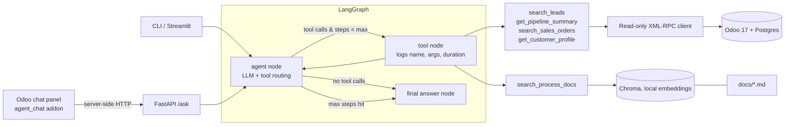

# Odoo Business Agent

A small LangGraph agent that answers business questions over an **Odoo 17** instance (CRM + Sales), combining
**tool calling** against live data with **RAG** over internal process docs, plus a reproducible **evaluation** harness.
All data is Odoo's synthetic demo data. Nothing here touches real client data.

## Architecture



- `odoo_agent/odoo_client.py`: XML-RPC wrapper. Only `search_read` and `read_group` can be sent; anything else raises.
- `odoo_agent/tools.py`: typed LangChain tools with docstrings the model reads.
- `odoo_agent/rag.py`: chunks `docs/*.md` by heading, indexes into Chroma (default local ONNX embedder, so no embedding API key).
- `odoo_agent/agent.py`: graph with a step guard (`MAX_STEPS=6`); at the limit the final node forces an answer from what was gathered. Returns the tools called, steps, tokens and latency.
- `odoo_agent/api.py` + `odoo_addons/agent_chat/`: HTTP wrapper and an Odoo 17 addon that adds a chat icon to the top bar. The addon's controller proxies questions to the `agent` container server-side, so the browser never talks to the agent directly.
- `evals/`: 21 questions, scoring and a report generator.

## Setup

Requires Docker and Python 3.11.

```bash
cp .env.example .env            # add ANTHROPIC_API_KEY or OPENAI_API_KEY
docker compose up -d            # first start installs modules + demo data (a few minutes); Odoo UI at :8069 (admin/admin)
uv venv --python 3.11 && uv pip install -r requirements.txt   # or: python3.11 -m venv .venv && pip install -r requirements.txt
source .venv/bin/activate
python -m odoo_agent "how many leads are in qualified stage?"
streamlit run streamlit_app.py
```

`docker compose up -d --build` also starts the `agent` API (port 8000) and installs the **Agent Chat** addon, so after logging in to Odoo
(http://localhost:8069, admin/admin) click the speech-bubble icon in the top bar to ask questions inside Odoo.
The init step is idempotent: demo data is installed once; later runs only update the addon.

Provider: whichever key is present (Anthropic, then OpenAI, then Gemini); force one with `LLM_PROVIDER`, override the model with `LLM_MODEL`.
The first RAG query downloads Chroma's small embedding model (~80 MB) once. Add `-v` to the CLI to log every step.

## Example questions

- How many leads are in the Qualified stage?
- What is the total expected revenue by salesperson?
- Show me draft quotations for Ready Mat.
- Give me a profile of Gemini Furniture.
- Who has to approve a 700 EUR refund?
- How many leads are Qualified, and what is that stage's default win probability? *(data + docs)*

## Tests and evaluation

```bash
pytest                      # Odoo client, tools, RAG, agent graph, scoring (all mocked/offline)
python -m evals.run         # needs Odoo running + an LLM key; writes evals/REPORT.md
```

Data questions compute their expected value live from Odoo (`truth` spec in `questions.jsonl`), so the set stays
valid whatever the demo data holds. Tool selection counts as correct when the calls cover an acceptable tool set and
use no tool outside the acceptable sets. Numbers use exact match (0.5 tolerance on currency sums); text uses an LLM judge.

### Results

Single run on 2026-10-22, `gemini-3.5-flash-lite` (free tier) as both agent and judge, against the Odoo 17 demo data. Full per-question detail is in [`evals/REPORT.md`](evals/REPORT.md).

| Metric | Result |
|---|---|
| Tool-selection accuracy | 95% (20/21) |
| Answer correctness | 95% (20/21) |
| Latency p50 / p95 | 19.1s / 24.2s |
| Avg tokens / question (in + out) | 2192 + 54 |

| Category | n | Tool selection | Answer correct |
|---|---|---|---|
| data | 10 | 10/10 | 10/10 |
| process | 7 | 7/7 | 7/7 |
| multi-step | 4 | 3/4 | 3/4 |

**The one failure (m04):** asked how many orders Gemini Furniture has (13), the agent called `get_customer_profile`
instead of `search_sales_orders`. The profile tool returns only the 10 latest orders, so the answer was 10. This is a real
tool-design weakness: the profile tool should return the total order count, or its docstring should say it is capped.
Latency is dominated by free-tier rate limiting (about 9s per model call), not by Odoo or retrieval.

## Limitations

- Read-only by design; it cannot create or update records.
- Date filters use Odoo's stored UTC timestamps; no timezone handling.
- List tools cap at 25 rows (the total count is still exact); `get_customer_profile` uses the first name match and 10 latest orders.
- The question set is small (21), results come from a single run, and the judge is an LLM (here the same model as the agent), so scores are indicative, not statistically robust.
- The Odoo chat panel queries Odoo as the `.env` user (demo `admin`), not as the logged-in Odoo user, so every user sees the same data. It would need per-user credentials before any real use.
- The addon has no automated tests; it was checked manually in the browser.
- No conversation memory: each question is independent.
- RAG is top-3 dense retrieval with heading-level chunks, with no reranking. The docs are short, synthetic samples.
- Odoo credentials default to the demo `admin/admin`; do not reuse this setup against a real instance.
